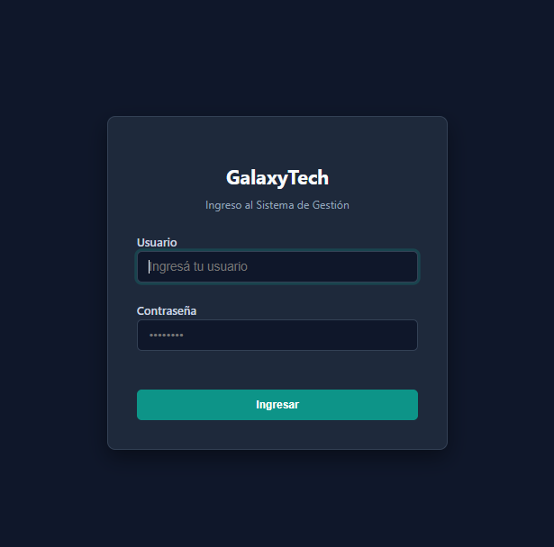
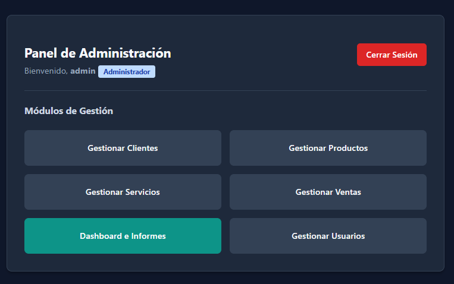

# GalaxyTech — Sistema de Gestión Comercial y Servicio Técnico

Sistema web para administrar inventario, ventas, clientes, usuarios y reparaciones de equipos informáticos en un comercio tecnológico, pensado para administradores y vendedores sin depender de frameworks externos.

## Tecnologías
HTML5 · CSS3 · JavaScript (Fetch API) · PHP · MySQL · Git

## Instalación
1. Clonar o descargar el repositorio en el directorio del servidor local (por ejemplo, `htdocs` en XAMPP): `git clone <url-del-repositorio>`
2. Crear la base de datos `galaxytech_db` en MySQL / phpMyAdmin e importar los scripts SQL correspondientes desde la carpeta de base de datos (`basedato/`).
3. Configurar las credenciales de acceso a la base de datos en `config/conexion.php`.
4. Iniciar Apache y MySQL y abrir en el navegador `http://localhost/trabajo-integrador-Algarin-Hentsch/galaxytech/login.php`.

## Usuarios de prueba
| Rol | Usuario | Contraseña |
| :--- | :--- | :--- |
| Admin | `admin` | `admin123` |
| Vendedor | `vendedor1` | `vendedor123` |

## Capturas

## Versión actual
v1.0.0 — ver [CHANGELOG](CHANGELOG.md)

## Integrantes
- Alan Hentsch (@alanhentsch)
- Ramón Algarín (@ramonalgarin)